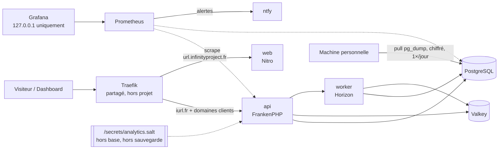

# 08 — Environnements, DNS, déploiement, exploitation

Tout ce qui doit être vrai **avant** le premier commit et le jour de la mise en ligne. Ce document est fait pour être suivi ligne à ligne.

---

## 1. Environnements

| Environnement | Où | Usage |
| --- | --- | --- |
| **Local** | Machine de développement, `compose.yml` | Développement, tests, Mailpit |
| **Production** | VPS OVH, même machine que les autres projets | Le service réel |
| **Labo TLS** | `lab.infinityproject.fr`, sur la même machine | Expériences de certificats avec **ACME staging** uniquement |

**Pas d'environnement de staging complet en v0.1.** Un solo ne peut pas maintenir deux stacks. Le labo TLS existe uniquement parce que l'émission de certificats est la partie risquée : on l'expérimente sur un hôte jetable, jamais sur `iurl.fr` ni sur un domaine client.

Règle : **ACME staging en local et au labo, ACME production uniquement en production.** Les rate limits de Let's Encrypt (50 certificats par domaine enregistré et par semaine) se consomment en une après-midi.

---

## 2. Certificats

Trois certificats pour le produit, un par hôte, tous en HTTP-01. Pas de wildcard : les liens sont `iurl.fr/{slug}`, donc aucun sous-domaine n'est nécessaire — et un wildcard imposerait DNS-01, donc une délégation DNS dont on n'a pas besoin.

| Hôte | Certificat | Note |
| --- | --- | --- |
| `iurl.fr` | 1, apex seul | Ne couvre pas `*.iurl.fr` |
| `url.infinityproject.fr` | 1 | Dashboard et marketing |
| `api.url.infinityproject.fr` | 1 | API |
| `infinityproject.fr` | 1 | Maison — actuellement cassé, à réparer |
| `qrcode.infinityproject.fr` | déjà en place | Autre produit |

Renouvellement automatique par Traefik. Trois certificats, c'est très loin du quota Let's Encrypt (50 par domaine enregistré et par semaine).

## 3. Plan DNS

Tout chez OVH. TTL à 300 pendant la mise en place, à 3600 ensuite.

| Nom | Type | Valeur | Rôle |
| --- | --- | --- | --- |
| `infinityproject.fr` | A / AAAA | IP du VPS | Site de la maison |
| `www.infinityproject.fr` | CNAME | `infinityproject.fr` | Redirection |
| `url.infinityproject.fr` | A / AAAA | IP du VPS | Dashboard + marketing d'Infinity URL |
| `api.url.infinityproject.fr` | A / AAAA | IP du VPS | API d'Infinity URL (D-103) |
| `qrcode.infinityproject.fr` | A / AAAA | IP du VPS | Déjà en place |
| `lab.infinityproject.fr` | A / AAAA | IP du VPS | Labo TLS, ACME staging |
| `iurl.fr` | A / AAAA | IP du VPS | Redirections uniquement |
| `infinityproject.fr` | TXT | `v=spf1 include:mxplan.ovh.net ~all` | SPF — à confirmer dans l'interface OVH |
| `<selecteur>._domainkey.infinityproject.fr` | TXT | fourni par OVH | DKIM |
| `_dmarc.infinityproject.fr` | TXT | `v=DMARC1; p=quarantine; rua=mailto:dmarc@infinityproject.fr; adkim=s; aspf=s` | DMARC |
| `iurl.fr` | TXT | `v=spf1 -all` | **Le domaine de liens n'envoie jamais d'email.** Bloque l'usurpation |
| `iurl.fr` | CAA | `0 issue "letsencrypt.org"` | Empêche un autre émetteur de certifier le domaine |
| `_dmarc.iurl.fr` | TXT | `v=DMARC1; p=reject;` | Idem |

`v=spf1 -all` sur `iurl.fr` est un détail qui compte : un raccourcisseur dont le domaine peut être usurpé en email devient un vecteur de phishing, même si `iurl.fr` ne sert que des redirections.

Après configuration, vérifier l'alignement SPF/DKIM/DMARC avec un envoi réel vers une adresse Gmail et l'en-tête `Authentication-Results`.

---

## 4. Traefik

Traefik est déjà en production sur la machine. Le shortener s'y branche, il ne le remplace pas.

### 3.1 Trois routeurs

| Hôte | Service | Particularité |
| --- | --- | --- |
| `iurl.fr` | `api` | **Aucun middleware d'authentification, aucun cookie, aucun accès log applicatif** |
| `url.infinityproject.fr` | `web` | `noindex`, `X-Robots-Tag` |
| `api.url.infinityproject.fr` | `api` | Rate limiting, CORS avec credentials |

### 3.2 CORS et cookie de session

Le dashboard (`url.infinityproject.fr`) et l'API (`api.url.infinityproject.fr`) sont **deux origines distinctes**, mais **le même site** au sens de `SameSite` (même domaine enregistrable). C'est ce qui rend le montage simple :

```http
Access-Control-Allow-Origin: https://url.infinityproject.fr
Access-Control-Allow-Credentials: true
Access-Control-Allow-Headers: Authorization, Content-Type
Access-Control-Allow-Methods: GET, POST, PATCH, DELETE, OPTIONS
Access-Control-Max-Age: 600
Vary: Origin
```

| Point | Règle |
| --- | --- |
| Origine autorisée | **Une seule**, écrite en dur. Jamais `*` avec `Allow-Credentials` (le navigateur le refuse de toute façon) |
| Préflight | Mis en cache 10 minutes par `Access-Control-Max-Age`, sinon chaque `PATCH` coûte un aller-retour |
| Cookie | `__Host-iurl_refresh`, `HttpOnly`, `Secure`, `SameSite=Lax`, `Path=/`, **sans attribut `Domain`** |
| Portée du cookie | Uniquement `api.url.infinityproject.fr`. Il n'est **jamais** envoyé à `url.`, ni à `iurl.fr` |
| Appel du dashboard | `fetch(..., { credentials: 'include' })` |
| Origine API publique | Les clients tiers utilisent un Bearer, donc pas de CORS nécessaire pour eux |

`SameSite=Lax` suffit ici : le navigateur envoie le cookie sur une requête `fetch` entre deux hôtes du **même site**, donc `url.` → `api.url.` passe. Si l'API vivait sur un domaine enregistrable différent, il faudrait `SameSite=None; Secure`, avec les contraintes que ça impose.

**Pourquoi pas de `Domain`** : un cookie `Domain=.url.infinityproject.fr` serait envoyé à tout sous-domaine présent ou futur sous `url.`. Le jour où un blog ou une preview y est ajouté, une faille sur cet hôte devient un vol de session. Le cookie host-only et le préfixe `__Host-` (qui interdit justement `Domain`) éliminent cette classe de risque.

### 3.3 Domaines clients : on-demand avec `ask` — v0.2 (D-127)

**Hors v0.1.** En v0.1, tous les liens vivent sur `iurl.fr` et trois certificats suffisent. Cette section est conservée pour la v0.2 : c'est la partie la plus risquée du produit, autant qu'elle soit écrite d'avance.

Un routeur attrape-tout sur le port 443, et l'émission de certificat est conditionnée par un appel à l'API :

```yaml
# Résolveur dédié aux domaines clients
certificatesResolvers:
  le-ondemand:
    acme:
      email: admin@infinityproject.fr
      storage: /acme/acme.json
      onDemand: true
      httpChallenge:
        entrypoint: web
      # caserver: https://acme-staging-v02.api.letsencrypt.org/directory   # labo uniquement
```

```yaml
# Routeur attrape-tout : ne certifie que ce que l'API autorise
http:
  routers:
    customer-links:
      rule: HostRegexp(`^.+$`)
      entryPoints: [websecure]
      priority: 1
      service: api
      tls:
        certResolver: le-ondemand
        domains:
          - main: "{{ .Host }}"
```

Traefik appelle ensuite l'endpoint `ask` :

```
GET http://api:8080/internal/tls/ask?domain=example.com
200 → certificat autorisé
404 → refusé
```

**L'endpoint doit échouer en refus par défaut.** Il ne répond `200` que si le domaine existe en base, est `verified_at is not null`, `status = 'active'` et `deleted_at is null`. C'est le seul rempart contre quelqu'un qui pointerait 10 000 domaines vers ton IP pour épuiser ton quota ACME.

### 3.4 Pièges connus

- **CNAME impossible à l'apex** (`example.com` sans sous-domaine). Documenter deux options pour le client : `go.example.com`, ou un `ALIAS`/`ANAME` si son fournisseur DNS le permet.
- **CAA chez le client** : s'il en a un, il doit y ajouter `letsencrypt.org`, sinon l'émission échoue avec une erreur peu explicite. À mettre dans la documentation d'ajout de domaine.
- **Cloudflare en mode proxy** : fonctionne, mais le challenge HTTP-01 doit traverser. Documenter « proxy désactivé pendant la vérification » pour éviter les tickets.
- **`/.well-known/acme-challenge`** doit rester accessible en HTTP. Ne pas forcer une redirection 301 globale avant que Traefik n'ait traité le challenge.

### 3.5 Rate limiting de la redirection (S3)

La configuration Traefik vit sur le serveur, hors de ce dépôt. Deux limites, deux
endroits :

```yaml
http:
  middlewares:
    iurl-ratelimit:
      rateLimit:
        average: 1200
        period: 1m
        burst: 1200
  routers:
    iurl:
      rule: Host(`iurl.fr`)
      middlewares: [iurl-ratelimit]
      service: api
```

`rateLimit` compte les requêtes par routeur, pas les réponses par code : Traefik
ne peut pas limiter les seuls `404`. Le plafond ci-dessus couvre donc toute la
redirection, et l'anti-énumération (60 `404` par minute et par IP empreintée au
sel, TTL 60 s) est un limiteur applicatif exécuté après la réponse, sur le seul
chemin froid. Voir l'ADR 0002.

---

## 5. Compose

Le shortener est un projet compose autonome, branché sur le réseau Traefik existant (D-61).



`postgres` et `valkey` ne sont sur aucun réseau exposé. L'API et le worker ne sont jamais joignables directement depuis Internet.

```yaml
networks:
  traefik:
    external: true
  backend:
    internal: true

services:
  api:
    image: ghcr.io/infinityproject/infinity-url-api:${TAG}
    networks: [traefik, backend]
    env_file: .env
    volumes:
      - ./secrets:/secrets:ro
    deploy:
      resources:
        limits: { memory: 512M, cpus: "1.0" }
    labels: { traefik.enable: "true", ... }

  worker:
    image: ghcr.io/infinityproject/infinity-url-api:${TAG}
    command: ["php", "artisan", "horizon"]
    networks: [backend]
    deploy:
      resources:
        limits: { memory: 256M }

  web:
    image: ghcr.io/infinityproject/infinity-url:${TAG}
    networks: [traefik, backend]
    deploy:
      resources:
        limits: { memory: 256M }

  postgres:
    image: postgres:17-alpine
    networks: [backend]
    volumes: [pgdata:/var/lib/postgresql/data]
    deploy:
      resources:
        limits: { memory: 1G }

  valkey:
    image: valkey/valkey:8-alpine
    command: ["valkey-server", "--maxmemory", "256mb", "--maxmemory-policy", "volatile-lru"]
    networks: [backend]

  prometheus: { ... }
  grafana:    { ... }
  ntfy:       { ... }
```

**`postgres` et `valkey` ne sont sur aucun réseau exposé.** Pas de port publié, pas d'accès depuis l'hôte sauf pour les sauvegardes, qui passent par `docker compose exec`.

---

## 6. Secrets

| Secret | Où | Rotation |
| --- | --- | --- |
| `APP_KEY` | `.env` (600) | Rotation = perte des TOTP chiffrés, à éviter |
| **`BLIND_INDEX_KEY`** | `.env` (600) | **Ne tourne jamais.** La rotation imposerait un re-hachage de tous les `email_hash`, en transaction. C'est la raison pour laquelle elle est distincte d'`APP_KEY` (D-110) |
| Mot de passe Postgres | `.env` | Annuelle |
| Jetons API | Hash en base | À la demande de l'utilisateur |
| **Sel analytique** | **Fichier `/secrets/analytics.salt`, hors base et hors sauvegarde** | Hebdomadaire, automatique |

Le sel mérite une explication, parce qu'il est le seul secret dont la destruction est une **promesse publique** :

- il n'est **jamais** en base de données : un dump de la base ne doit pas permettre de tester une IP candidate ;
- il n'est **jamais** dans la sauvegarde : sinon « détruit à la rotation » serait faux ;
- la rotation écrit un nouveau fichier par `rename` atomique, puis **écrase** l'ancien avant de le supprimer ;
- l'application relit le fichier au changement de `mtime`, sans redémarrage ;
- les clés de dédup en Valkey expirent d'elles-mêmes au plus tard à la rotation suivante.

**En développement**, le sel vit hors du dépôt, par exemple dans
`~/.config/infinity-url/analytics.salt` en `0600`, et `ANALYTICS_SALT_PATH` du
`.env` local pointe dessus. `php artisan analytics:rotate-salt` le crée ou le
remplace. Les tests fabriquent leur propre fichier temporaire et ne lisent jamais
celui du poste.

`.env.example` est versionné, `.env` jamais. Les valeurs réelles vivent dans un gestionnaire de mots de passe, pas dans un fichier texte sur le VPS.

---

## 7. Ressources

| Conteneur | Limite mémoire | Note |
| --- | --- | --- |
| `api` | 512 Mo | Plafonner les threads FrankenPHP en conséquence |
| `worker` | 256 Mo | `--max-time` sur Horizon pour éviter les fuites |
| `web` | 256 Mo | Nitro |
| `postgres` | 1 Go | `shared_buffers` ≈ 256 Mo |
| `valkey` | 256 Mo | `volatile-lru` : toutes les clés ont un TTL |
| `prometheus` | 512 Mo | Rétention 15 jours |
| `grafana` | 256 Mo | — |
| `ntfy` | 128 Mo | — |
| **Total** | **≈ 3,2 Go** | Sur un VPS 4 vCPU / 8 Go, il reste de la marge pour les autres projets |

Sans ces limites, un pic de redirections fait tomber les autres projets hébergés sur la même machine. C'est le sens de D-62.

---

## 8. Déploiement

```
CI (GitHub Actions)                   VPS
─────────────────────                 ─────────────────────
build image API  ──► ghcr.io/...:TAG
build image Web  ──► ghcr.io/...:TAG  docker compose pull
                                       docker compose run --rm api php artisan migrate --force
                                       docker compose up -d
```

- **Images construites en CI, jamais sur le serveur.** Le VPS ne compile pas : il tire. C'est plus rapide, reproductible, et ça permet un retour arrière par tag.
- **Retour arrière** : `TAG=<précédent> docker compose up -d`. Aucune reconstruction.
- **Migrations** : commande séparée, avant `up`, jamais dans l'entrypoint (sinon deux répliques migrent en même temps).
- **Zéro coupure** : non, et c'est assumé. `up -d` provoque une coupure de quelques secondes. Pour un produit sans SLA (D-27), c'est acceptable. Un `frankenphp reload` suffit pour un changement de code sans migration.
- **Dépôts publics** ⇒ packages GHCR gratuits et minutes Actions illimitées.

---

## 9. Logs

Contrainte légale : **72 heures maximum**, IP non loggée côté applicatif (D-32, D-36).

| Couche | Réglage |
| --- | --- |
| journald | `MaxRetentionSec=72h`, `SystemMaxUse=500M` dans `/etc/systemd/journald.conf` |
| Docker | `logging.driver: journald` pour tous les services |
| Traefik (access log) | Activé, format personnalisé **sans query string**, IP non désactivée (elle sert à la sécurité) |
| Application | Monolog vers stderr, **jamais `REMOTE_ADDR`**, handler qui pousse `ERROR`/`CRITICAL` vers ntfy |

journald est préféré au driver `json-file` parce que `MaxRetentionSec` borne réellement **en temps**. Le driver Docker standard ne sait tourner qu'en taille, ce qui ne garantit pas les 72 h.

Vérification à faire une fois : provoquer une erreur, attendre 73 h (ou simuler avec `journalctl --vacuum-time=72h`), confirmer que la ligne a disparu.

---

## 10. Sauvegarde

Conforme à D-102, modèle **pull**.

Sur la machine personnelle, un timer systemd quotidien :

```bash
pg_dump -Fc -h <vps> -U backup infinity_url \
  | age -r "$(cat ~/.config/age/recipient.txt)" \
  > ~/backups/infinity-url-$(date +%F).dump.age

find ~/backups -name 'infinity-url-*.dump.age' -mtime +30 -delete
```

- Le serveur ne détient **aucun** identifiant de sauvegarde : s'il est compromis, l'archive reste intacte.
- La restauration se teste avec `pg_restore` dans une base jetable, chronomètre en main.
- Le dump contient les emails des utilisateurs : chiffrement obligatoire, même sur un disque personnel.

---

## 11. Supervision et alertes

Prometheus + Grafana + ntfy, auto-hébergés (D-99).

### 10.1 Exporters

| Exporter | Ce qu'il expose |
| --- | --- |
| `node_exporter` | CPU, RAM, disque, réseau |
| `postgres_exporter` | Connexions, requêtes lentes, taille |
| `frankenphp` (métriques natives) | Requêtes, latence, threads |
| Métriques applicatives | Hit ratio du cache, profondeur de file, jobs échoués, liens expirés, certificats |

### 10.2 Règles d'alerte

| Alerte | Seuil | Pourquoi |
| --- | --- | --- |
| **Certificat client expirant** | < 14 jours | v0.2. **L'oubli classique** : un domaine client casse en silence |
| **Domaine blacklisté** | Présence sur une blocklist | D-113. Avec un seul domaine, c'est l'alerte qui remplace l'isolation |
| Taux de 5xx | > 1 % sur 5 min | Le service ne répond plus correctement |
| Latence p95 de redirection | > 200 ms sur 10 min | Le cache est débranché ou la base sature |
| Taux de hit du cache | < 80 % sur 15 min | Signal avancé de saturation |
| Profondeur de file | > 1 000 sur 10 min | Les clics sont perdus |
| Jobs échoués | > 0 | L'analytique ne s'écrit plus |
| Disque | > 80 % | La purge des logs a échoué |
| Postgres connexions | > 80 % du max | Saturation imminente |
| Job de rotation du sel | Absence d'exécution lundi | La promesse de destruction n'est plus tenue |

Les alertes partent vers ntfy par webhook. Grafana **n'est pas exposé publiquement** : `127.0.0.1` plus tunnel SSH (ou Tailscale).

**Les métriques sont des agrégats** : aucune donnée personnelle, aucun impact sur le LIA. C'est ce qui permet de les garder 15 jours sans contradiction avec la rétention des logs.

---

## 12. Durcissement du serveur

| Mesure | Détail |
| --- | --- |
| SSH | Clés uniquement, `PermitRootLogin no`, port non standard facultatif |
| Pare-feu | nftables : n'autoriser que 22, 80, 443 |
| Mises à jour | `unattended-upgrades` pour les correctifs de sécurité |
| Docker | Pas de socket monté, conteneurs non privilégiés, `no-new-privileges` |
| Traefik | Rate limiting global, `X-Forwarded-For` de confiance uniquement |
| Fail2ban | Sur Traefik (401/403 répétés) et sur SSH |
| ntfy | Authentification obligatoire, sujet non devinable |

---

## 13. Checklist de première mise en service

1. DNS posé, TTL 300, propagation vérifiée avec `dig`.
2. Certificats pour `infinityproject.fr`, `url.`, `api.`, `iurl.fr` — **y compris l'apex `infinityproject.fr`, actuellement cassé**.
3. `php artisan migrate --force` exécuté.
4. `reserved_slugs` semé, test de collision avec les routes qui passe.
5. Un compte administrateur créé à la main, inscriptions publiques encore fermées (`SIGNUPS_OPEN=false`).
6. Envoi d'un email de vérification réel, en-têtes SPF/DKIM/DMARC validés.
7. Job de blocklist exécuté une fois, table non vide.
8. Rotation du sel testée à blanc : l'ancien sel n'est plus lisible après.
9. Sauvegarde effectuée, **restauration chronométrée** dans une base jetable.
10. Une alerte de test arrive bien sur ntfy.
11. Purge des logs vérifiée à 72 h (simulation).
12. `curl -sI https://iurl.fr/<slug>` : aucun `Set-Cookie`, aucun script, `302`.
13. Ouverture des inscriptions.

---

## 14. Ce qui reste volontairement manuel

- L'approbation des 50 premiers comptes (D-21).
- L'ajout d'une entrée dans la blocklist locale après un signalement.
- La bascule du second domaine sacrifiable, quand il existera.
- Le passage à un stockage de sauvegarde hors site, au premier client payant.

---

## 15. Paquets et versions (D-115)

### Backend — Composer

| Paquet | Version | Rôle |
| --- | --- | --- |
| `laravel/framework` | `^13.0` | Exige PHP `^8.3`, on pinne **8.4** |
| `laravel/sanctum` | `^4.5` | Jetons, abilities, expiration, `sanctum:prune-expired` |
| `laravel/horizon` | `^5.52` | File analytique |
| `dedoc/scramble` | `^0.13` | OpenAPI 3.1 généré depuis les routes |
| `matomo/device-detector` | `^6.5` | Appareil **et** bots, hors ligne |
| `jeremykendall/php-domain-parser` | `^6.4` | Domaine enregistrable (PSL) pour les blocklists |
| `pragmarx/google2fa` | `^9.1` | TOTP, fenêtre ±1 pas |
| `ext-redis` (phpredis) | — | Client Valkey, plus rapide que Predis sur le chemin chaud |

Développement : `pestphp/pest ^5.3`, `larastan/larastan ^3.15`, `laravel/pint`.

### Frontend — npm

| Paquet | Version | Rôle |
| --- | --- | --- |
| `nuxt` | `^4.6` | — |
| `@nuxtjs/i18n` | `^10.6` | FR + EN, `prefix_except_default` |
| `@infinitylib/infinity-theme` | `^0.2` | Tokens CSS |
| `@infinitylib/infinity-theme-vue` | `^0.1` | Wrappers Vue |
| `@infinitylib/iqrcode-wasm` | `0.2.0` **exact** | QR côté client |
| `pinia` + `@pinia/nuxt` | `^4.1` / `^1.0` | État |
| `chart.js` | `^4.6` | Graphique des statistiques |
| `openapi-fetch` | `^0.17` | Client typé, 6 Ko |
| `openapi-typescript` | `^7.13` | Génération des types depuis la spec (dev) |
| `zod` | `^4.6` | Validation côté client uniquement |

Développement : `vitest ^5.1`, `@nuxt/test-utils ^4.4`, `@playwright/test ^1.65`.

### Ce qu'on n'installe pas, et pourquoi

| Écarté | Raison |
| --- | --- |
| **Fortify, Breeze, Jetstream** | Échafaudages de session Blade/SPA. On n'utilise que `pragmarx/google2fa` et le broker de mot de passe intégré |
| `laravel/cashier` | Facturation hors v0.1 |
| `laravel/telescope` | Surface inutile en production |
| `sentry/sentry-laravel` | D-99 : supervision auto-hébergée |
| `spatie/laravel-backup` | Un `pg_dump` suffit (D-102) |
| `spatie/laravel-permission` | `workspace_members.role` suffit |
| `axios` | `ofetch` est intégré à Nuxt |
| **Tailwind** | Le thème `infinitylib` porte déjà les styles |

**Règle** : aucun paquet sans usage démontré. Chaque dépendance ajoutée est une surface de mise à jour et un risque d'avis de sécurité.
