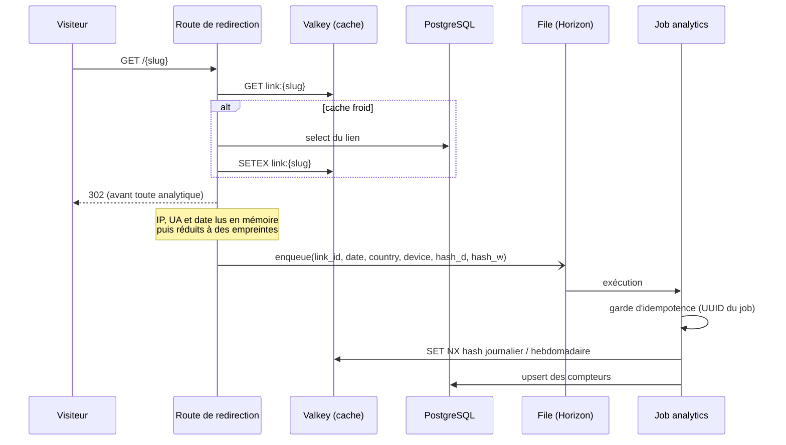

# 11 — Pipeline analytique : du clic au compteur

Décision D-107. Ce document décrit le seul chemin où une erreur est invisible : un compteur faux ne plante pas, il ment.

---

## 1. Vue d'ensemble



**Règle absolue** : la redirection ne dépend jamais de l'analytique. Si la file est pleine, si Valkey est lent, si le job échoue, le visiteur est redirigé quand même.

---

## 2. Ce qui se passe obligatoirement dans la requête

L'IP n'est jamais persistée, donc **tout ce qui en dépend doit être calculé avant la fin de la requête**. C'est la contrainte structurante de tout le pipeline.

| Donnée | Traitement | Ce qui sort |
| --- | --- | --- |
| IP | HMAC avec le sel, deux fois | `hash_d`, `hash_w` |
| User-agent | `device-detector` | `device` (`mobile`/`tablet`/`desktop`), `is_bot` |
| IP | base locale DB-IP (ou différée v0.2) | `country` (ISO 3166-1 alpha-2) |
| Horloge | `now()` figé | `date` au format `Y-m-d`, UTC |

Puis l'IP et le user-agent sont **abandonnés**. Rien de brut ne traverse la frontière de la requête.

### Les deux empreintes

```php
$date   = now('UTC')->toDateString();
$base   = $ip . '|' . $link->id;

$hashD = hash_hmac('sha256', $base . '|' . $date, $salt);  // uniques du jour
$hashW = hash_hmac('sha256', $base, $salt);                // uniques de la semaine
```

Deux empreintes, deux granularités, deux durées de vie :

| Empreinte | Clé Valkey | TTL |
| --- | --- | --- |
| Journalière | `u:d:{hashD}` | Jusqu'à minuit UTC, au plus tôt |
| Hebdomadaire | `u:w:{hashW}` | Jusqu'à la prochaine rotation du sel (lundi 00:00 UTC) |

Les deux clés survivent **une heure de plus** que leur bucket : un clic de 23h59
dont le job tourne à 00h00 est ainsi dédupliqué normalement. Passé cette grâce,
le bucket est fermé : le job compte le clic mais abandonne l'unique plutôt que
de le compter deux fois.

**Pourquoi deux et pas une.** Une seule clé ne peut produire qu'une granularité. Avec la seule clé hebdomadaire, un visiteur qui revient le mercredi ne serait pas compté dans les uniques du mercredi. L'empreinte journalière vit au plus 24 h : c'est la plus courte des deux, donc celle qui pèse le moins.

---

## 3. Payload du job

```json
{
  "link_id": 42,
  "date": "2026-11-21",
  "country": "FR",
  "device": "mobile",
  "hash_d": "9f2c…",
  "hash_w": "a1b2…"
}
```

Aucune donnée personnelle. Aucune IP, aucun user-agent, aucune URL de destination. C'est ce qui permet de journaliser un job échoué sans créer de fuite.

---

## 4. Traitement du job

```php
public function handle(AnalyticsCounter $counter): void
{
    // 1. Idempotence : un retry ne doit pas doubler les clics
    if (! Cache::add("job:{$this->job->uuid()}", 1, now()->addHours(6))) {
        return;
    }

    // 2. Bots : jamais comptés, ni clics ni uniques
    if ($this->isBot) {
        return;
    }

    // 3. Uniques, deux granularités
    $uniqueDay    = Cache::add("u:d:{$this->hashD}", 1, $this->endOfUtcDay());
    $uniqueWeek   = Cache::add("u:w:{$this->hashW}", 1, $this->nextSaltRotation());

    // 4. Compteurs
    $counter->incrementDay($this->linkId, $this->date, $uniqueDay);
    $counter->incrementWeek($this->linkId, $this->date, $uniqueWeek);
    $counter->incrementDimension($this->linkId, $this->date, 'device', $this->device);
    if ($this->country !== null) {
        $counter->incrementDimension($this->linkId, $this->date, 'country', $this->country);
    }
}
```

### 4.1 L'idempotence, et pourquoi elle est indispensable

Un job de clic peut être retenté : redémarrage du worker, OOM, déploiement, timeout. Sans garde :

- les **uniques** ne bougent pas, la clé `SET NX` échoue au second passage ;
- les **clics** sont incrémentés deux fois.

Résultat : un nombre de clics supérieur au réel, de façon intermittente et inexplicable. La garde utilise l'UUID du job, qui est **stable à travers les retries** car il fait partie du payload sérialisé.

La clé `job:{uuid}` vit 6 heures : assez pour couvrir toutes les tentatives d'un job, assez court pour ne pas peser.

### 4.2 Incréments atomiques

```sql
insert into link_stats_daily (link_id, date, clicks, uniques)
values (:link, :date, 1, :unique)
on conflict (link_id, date) do update
set clicks  = link_stats_daily.clicks  + 1,
    uniques = link_stats_daily.uniques + excluded.uniques;
```

Jamais de `select` puis `update` : deux jobs concurrents sur le même lien produiraient une perte d'incrément.

---

## 5. Bots et préchargements

| Cas | Décision |
| --- | --- |
| User-agent identifié comme bot | Écarté avant l'enqueue : aucun compteur, aucun job |
| Requête `HEAD` | Non comptée. C'est un scanner ou un préchargeur, pas une visite |
| `Sec-Purpose: prefetch` ou `Purpose: prefetch` | Non comptée. Le navigateur précharge, l'humain n'a pas cliqué |
| `X-Purpose: preview` | Non comptée |
| Requête sans `User-Agent` | Comptée, mais taguée `device = unknown`. Ne pas exclure : certains outils légitimes n'envoient pas d'UA |

**Le filtrage des bots est une décision produit autant qu'une décision technique.** Trop strict, tu perds des clics réels (les navigateurs en mode économie de données, les aperçus de messagerie). Trop laxiste, les stats deviennent inutilisables. La règle retenue : on n'exclut que ce qui est *identifié* comme bot, jamais ce qui est *inconnu*.

---

## 6. Date et fuseau horaire

- Toutes les dates sont en **UTC**, y compris la frontière des journées.
- La date est **capturée dans la requête** et transportée dans le payload. Le job utilise cette date, jamais `now()` : un job exécuté à 00:00:03 pour un clic de 23:59:58 doit compter sur la bonne journée.
- Conséquence assumée et documentée : un visiteur français qui clique à 00h30 locales est compté la veille.

---

## 7. Rotation du sel

| Moment | Effet |
| --- | --- |
| Lundi 00:00 UTC | Nouveau sel écrit, ancien écrasé puis supprimé |
| Immédiatement | Les empreintes hebdomadaires précédentes ne matchent plus rien |
| Naturellement | Les clés `u:w:*` expirent, les compteurs déjà écrits restent |
| Jamais | Aucune migration de données : les compteurs sont déjà agrégés |

Le job de rotation alerte s'il n'a pas tourné (voir `08-setup.md`, §11). Un sel non tourné n'est pas une panne visible : c'est une promesse de confidentialité qui cesse d'être tenue.

---

## 8. Modes de défaillance

Le principe est asymétrique, et c'est volontaire :

> **On échoue en ouvert sur la redirection, en fermé sur les compteurs.**

| Panne | Redirection | Analytique |
| --- | --- | --- |
| Valkey indisponible | Continue, lit en base | Les jobs échouent et sont retentés |
| Postgres indisponible | Sert depuis le cache ; `503` si cache froid | Les jobs échouent et sont retentés |
| File pleine ou indisponible | Continue | Événement perdu, métrique incrémentée, alerte ntfy |
| Sel introuvable | Continue | Clics comptés, **uniques abandonnés**, alerte `CRITICAL` |
| Job en échec définitif | Continue | Compté dans `failed_jobs`, purgé à 72 h, alerte |

**Ne jamais bloquer un visiteur parce qu'une statistique ne peut pas être écrite.** Un lien cassé est un incident client ; un clic non compté est un incident interne.

---

## 9. Rétention

| Donnée | Durée | Mécanisme |
| --- | --- | --- |
| `u:d:*` | Jusqu'à minuit UTC | TTL Valkey |
| `u:w:*` | Jusqu'à la rotation | TTL Valkey + destruction du sel |
| `job:*` | 6 heures | TTL Valkey |
| `link_stats_daily` | 30 jours (hébergé v0.1) | Job de purge quotidien |
| `link_stats_weekly` | 30 jours | Idem |
| `link_stats_weekly` | 30 jours | Idem |
| `link_stats_dim` | 30 jours | Idem |
| `failed_jobs` | 72 heures | `queue:prune-failed` |

Supprimer un lien supprime ses compteurs : la suppression logique efface
explicitement les trois tables dans la même transaction, et la cascade de clé
étrangère couvre l'effacement définitif. C'est la promesse d'effacement du LIA,
et elle n'est tenable que parce qu'il n'existe pas de lignes de clic.

---

## 10. Ce qui n'existe pas dans le pipeline

| Absent | Raison |
| --- | --- |
| IP dans le payload ou les logs | Fait mentir le LIA |
| User-agent persisté | Idem |
| Referer | Décision D-16 |
| Ligne par clic | Rend l'effacement impossible et crée un profil |
| Corrélation entre liens | Les empreintes sont scopées par `link_id` |
| Rejeu d'événement | La garde d'UUID l'empêche |
| Traitement au clic | La redirection ne fait aucun calcul statistique |

---

## 11. Tests associés

Détaillés dans `09-tests.md`, mais le pipeline en concentre quatre qui ne doivent jamais être supprimés :

1. même IP + deux `link_id` → deux empreintes différentes ;
2. un retry de job n'incrémente pas les clics une seconde fois ;
3. un bot ne crée ni clic ni unique ;
4. après rotation du sel, une empreinte calculée avec l'ancien sel ne correspond plus.
