# 12 — Modélisation UML ciblée

On ne modélise que ce qu'on **ne peut pas lire dans le code**. Un diagramme de classes qui duplique le schéma SQL sera faux dans deux semaines ; une machine à états qui décrit des transitions non évidentes restera vraie et utile.

---

## 1. Ce qu'on modélise, et ce qu'on ne modélise pas

| Diagramme | Verdict | Raison |
| --- | --- | --- |
| **Cas d'utilisation** | **Oui** | Sert de vérification de complétude : il révèle les fonctionnalités oubliées |
| **Machines à états** | **Oui** | Les transitions sont réelles, non évidentes, et sources de bugs |
| **Séquences** | **Oui**, pour six flux | Ce sont les flux avec état, où les erreurs se cachent |
| Diagramme de classes | **Non** | `07-schema.md` et les migrations sont la vérité. Un diagramme de classes serait une copie qui dérive |
| Diagramme d'activité | **Non** | Redondant avec `11-pipeline.md` et `04-abus-et-domaines.md` |
| Composants / déploiement | **Déjà fait** | Mermaid dans `08-setup.md`, §5 |
| BPMN | **Non** | Aucun processus métier à modéliser |

**Format : Mermaid uniquement**, dans le dépôt, rendu par GitHub. Pas d'images exportées : une image ne se relit pas en revue de code et ne se met jamais à jour.

---

## 2. Acteurs

| Acteur | Type | Description |
| --- | --- | --- |
| **Visiteur** | Humain | Ouvre un lien court ; n'a pas de compte, ne s'authentifie jamais |
| **Utilisateur** | Humain | Crée et gère des liens, consulte ses statistiques |
| **Client API** | Système | `iQuiz` ou un client tiers, authentifié par jeton |
| **Rapporteur** | Humain | Signale un lien abusif, sans compte |
| **Traefik** | Système | Demande l'autorisation d'émettre un certificat |
| **Planificateur** | Système | Rotation du sel, purge, rafraîchissement des blocklists |
| **Autorité de certification** | Externe | Let's Encrypt |
| **Exploitant** | Humain | Toi. Qualifie les signalements, approuve les premiers comptes |

---

## 3. Cas d'utilisation

Mermaid n'a pas de diagramme de cas d'utilisation natif. On utilise un `flowchart`, qui rend mieux sur GitHub qu'une image PlantUML et reste éditable.

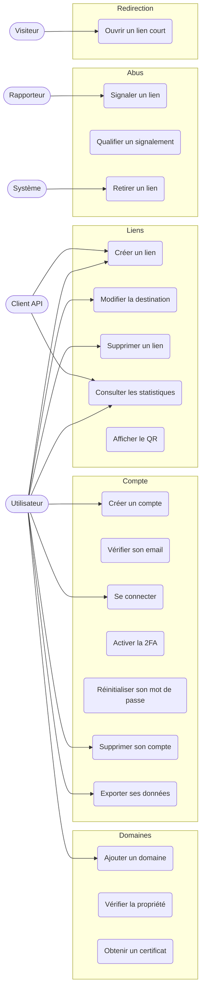

---

## 4. Matrice de couverture — et les huit trous qu'elle révèle

Chaque cas d'utilisation doit avoir **un endpoint, un écran et un test**. C'est la colonne « statut » qui a fait apparaître les manques.

### Compte

| Cas d'utilisation | Endpoint | Écran | Test | Statut |
| --- | --- | --- | --- | --- |
| Créer un compte | `POST /auth/register` | `/signup` | E2E 1 | OK |
| Vérifier son email | `POST /auth/verify-email` | `/verify` | E2E 1 | OK |
| Renvoyer l'email de vérification | `POST /auth/verification/resend` | `/verify` | Feature | OK |
| Se connecter | `POST /auth/login` | `/login` | E2E 1 | OK |
| Valider le TOTP | `POST /auth/2fa/verify` | `/login` | E2E | OK |
| Activer la 2FA | `POST /auth/2fa/enable` + `/confirm` | `/settings/security` | Feature | OK |
| Désactiver la 2FA | `POST /auth/2fa/disable` | `/settings/security` | Feature | OK |
| Régénérer les codes de récupération | `POST /auth/2fa/recovery-codes` | `/settings/security` | Feature | OK |
| Se déconnecter | `POST /auth/logout` | barre de nav | Feature | OK |
| Révoquer toutes les sessions | `POST /auth/logout-all` | `/settings/security` | Feature | OK |
| Changer de mot de passe | `PATCH /me/password` | `/settings/security` | Feature | OK |
| Mot de passe oublié | `POST /auth/password/forgot` | `/forgot` | Feature | OK |
| Réinitialiser | `POST /auth/password/reset` | `/reset` | Feature | OK |
| **Supprimer son compte** | `DELETE /me` | `/settings/danger` | Feature | OK |
| **Exporter ses données** | `GET /me/export` | `/settings/privacy` | Feature | OK |

### Liens

| Cas d'utilisation | Endpoint | Écran | Test | Statut |
| --- | --- | --- | --- | --- |
| Créer un lien | `POST /links` | `/links/new` | E2E 1 | OK |
| Lister et filtrer | `GET /links` | `/links` | Composant | OK |
| Voir le détail | `GET /links/{id}` | `/links/{id}` | Composant | OK |
| Modifier | `PATCH /links/{id}` | `/links/{id}` | Feature | OK |
| Supprimer | `DELETE /links/{id}` | `/links/{id}` | Feature | OK |
| Voir les statistiques | `GET /links/{id}/stats` | `/links/{id}` | Composant | OK |
| Exporter les statistiques (CSV) | `GET /links/{id}/stats.csv` | `/links/{id}` | Feature | OK |
| Afficher le QR | aucun (client) | `/links/{id}` | Spike S0 | OK |

### Domaines, jetons, abus

| Cas d'utilisation | Endpoint | Écran | Test | Statut |
| --- | --- | --- | --- | --- |
| Ajouter un domaine | `POST /domains` | `/domains/new` | — | **v0.2** (D-127) |
| Vérifier la propriété | `POST /domains/{id}/verify` | `/domains/{id}` | — | **v0.2** |
| Relancer le TLS | `POST /domains/{id}/recheck` | `/domains/{id}` | Feature | **v0.2** |
| Retirer un domaine | `DELETE /domains/{id}` | `/domains/{id}` | Feature | **v0.2** |
| Gérer les jetons | `GET/POST/DELETE /tokens` | `/settings/tokens` | Feature | OK |
| Signaler un lien | `POST /report` | `/report` | Feature | OK |
| Page publique d'abus | — (page statique, sans API) | `/abuse` | Takedown à blanc | OK |
| Qualifier et retirer | aucun (manuel) | — | Takedown à blanc | OK |

### Les huit ajouts, et pourquoi ils sont tous en v0.1

La matrice est désormais complète : plus aucune ligne « MANQUANT », depuis D-108 (les huit ajouts) et D-111 (export de portabilité).

| Manque | Coût | Pourquoi il ne peut pas attendre |
| --- | --- | --- |
| Renvoyer l'email de vérification | 1 h | Sans ça, un email perdu = un compte mort. Le rate limit est déjà défini |
| Changer de mot de passe | 2 h | Fonction attendue par tout utilisateur, et premier réflexe après un doute |
| Supprimer son compte | 3 h | **Promesse d'effacement.** Sans ça, le LIA et la politique de confidentialité sont faux |
| Désactiver la 2FA | 1 h | Sinon un téléphone perdu = un compte inaccessible définitivement |
| Régénérer les codes de récupération | 1 h | Une fois les 10 codes consommés, la 2FA devient un piège |
| Révoquer toutes les sessions | 1 h | Réponse minimale à un soupçon de compromission |
| Export CSV des statistiques | 2 h | Promesse de portabilité, et feature attendue par une agence |
| Page `/abuse` statique | 2 h | Le DSA suppose un mécanisme de notification **public et documenté** |

Soit **13 h environ**, à ajouter à l'estimation de la v0.1.

---

## 5. Machines à états

### 5.1 Lien

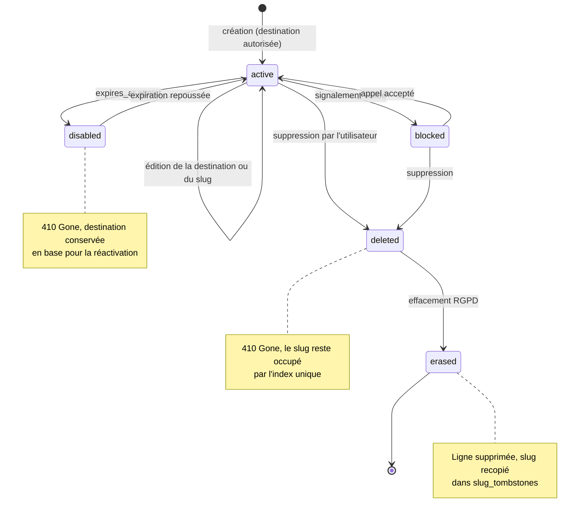

Transitions interdites, à faire échouer en test : `deleted → active` (un slug supprimé n'est jamais réactivé) et `erased → *` (rien).

### 5.2 Domaine — v0.2 (D-127)

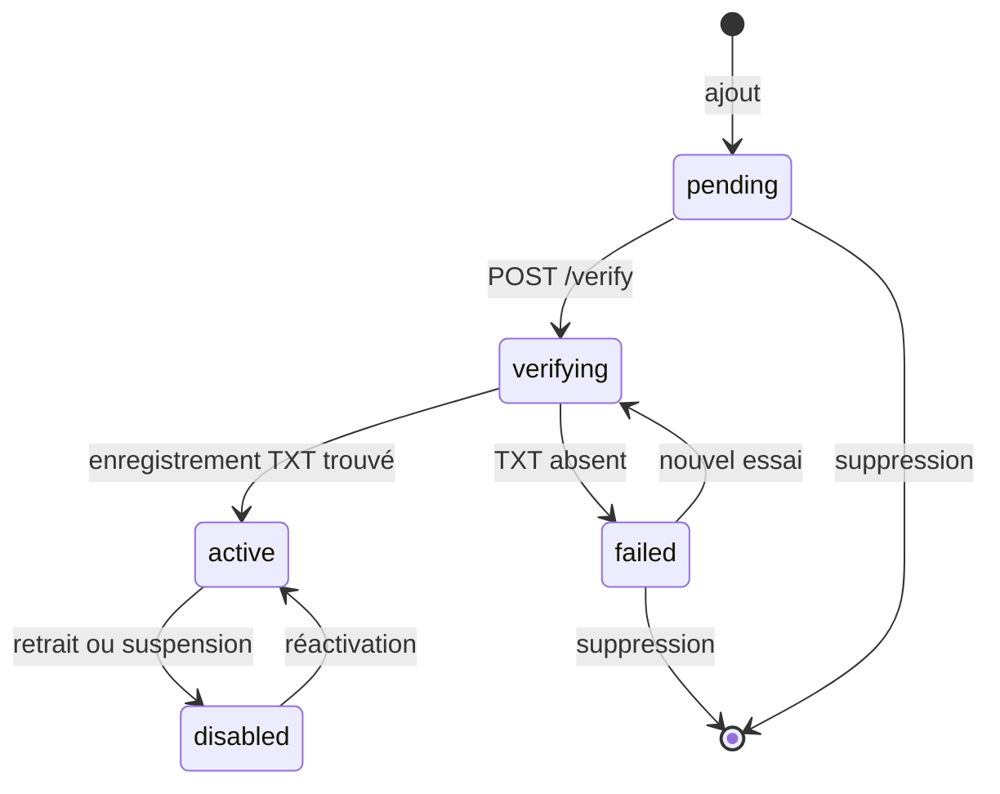

`active` exige `verified_at is not null`. C'est cette invariante que l'endpoint `ask` de Traefik vérifie, pas l'inverse.

### 5.3 Certificat TLS

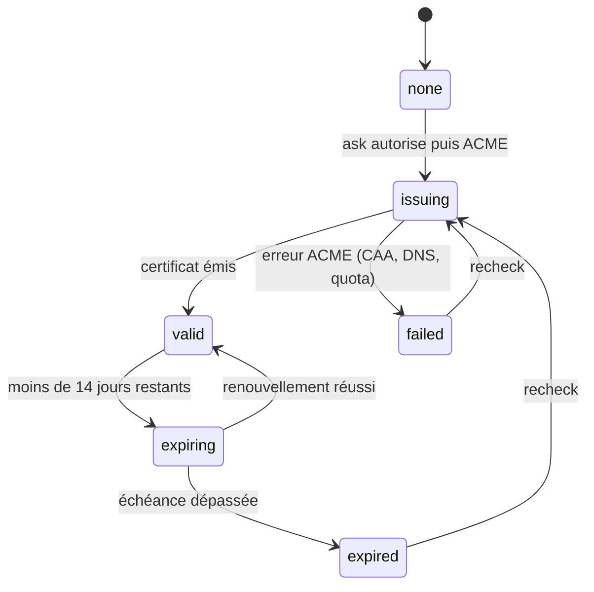

`expiring` est l'état qui déclenche l'alerte de `08-setup.md`. Un certificat qui passe de `valid` à `expired` sans passer par l'alerte est un incident de supervision, pas un accident.

### 5.4 Compte

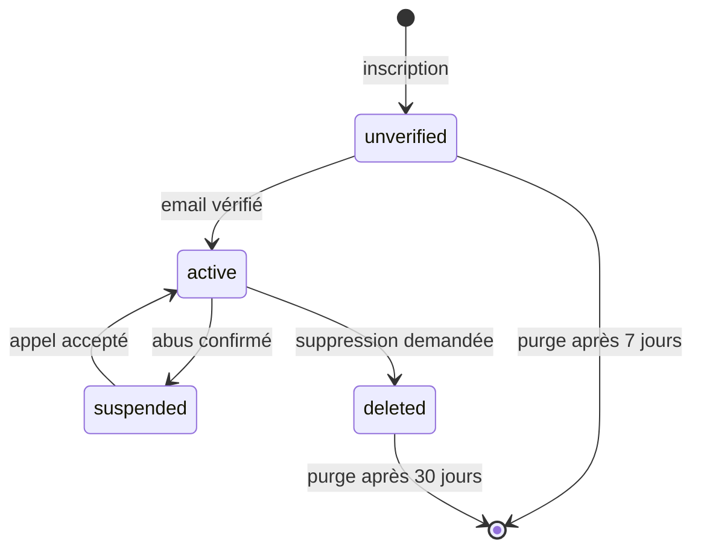

Un compte `unverified` ne peut **créer aucun lien**. C'est la barrière anti-abus la moins coûteuse.

### 5.5 Jeton API

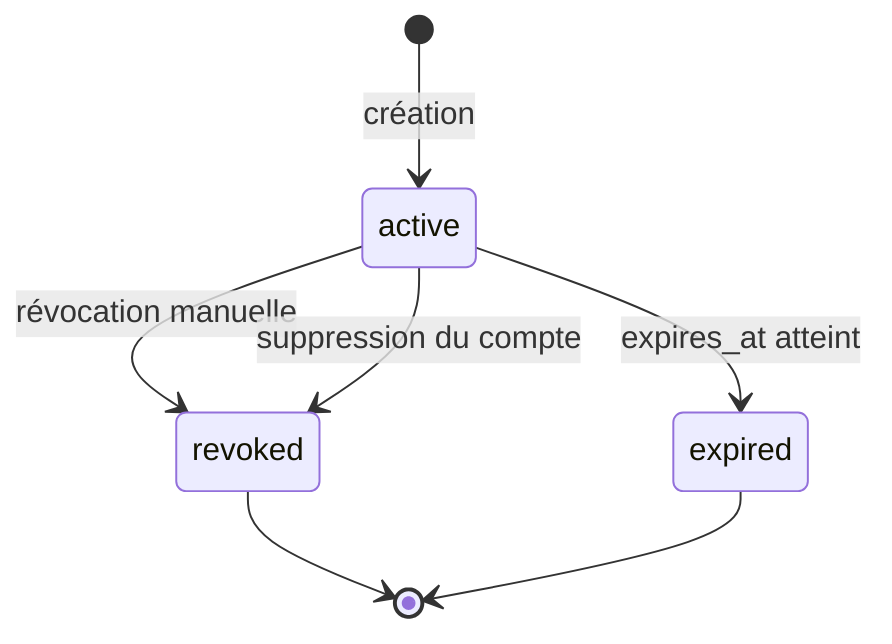

---

## 6. Diagrammes de séquence

Six flux, choisis parce qu'ils ont un état, une dépendance externe, ou une erreur silencieuse possible.

### 6.1 Inscription et vérification

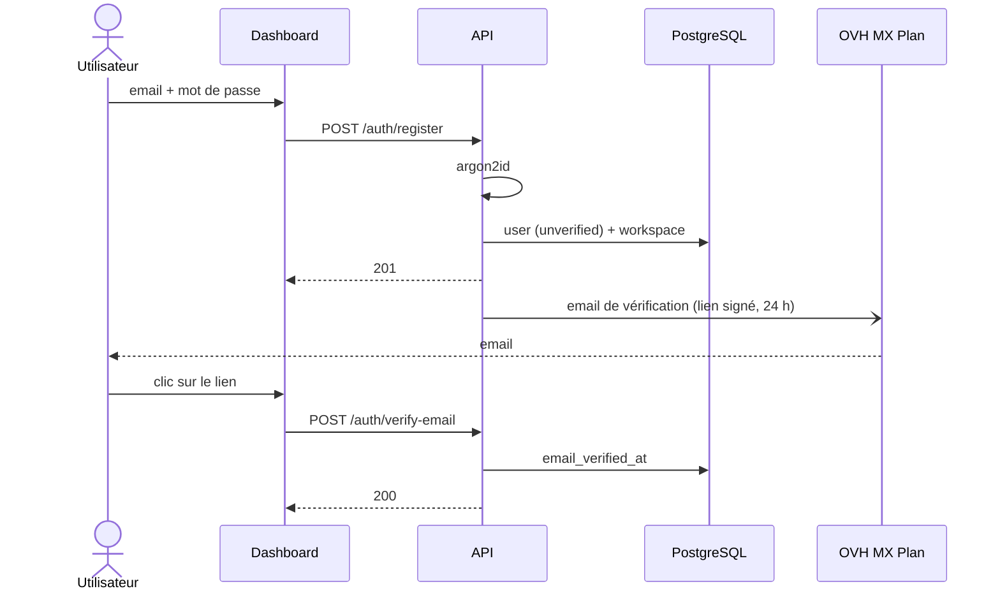

**Anti-énumération** : la réponse est **toujours `201`**, que l'adresse existe ou non. Si elle existe déjà, l'email envoyé est différent (« quelqu'un a tenté de créer un compte avec votre adresse »). Sans ça, l'endpoint devient un annuaire.

### 6.2 Connexion avec 2FA

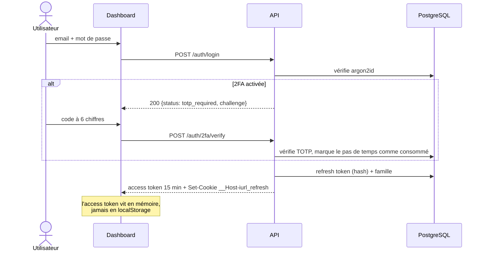

Le code TOTP consommé est mémorisé : sans ça, un code intercepté reste valable 30 secondes et peut être rejoué.

### 6.3 Rafraîchissement et détection de rejeu

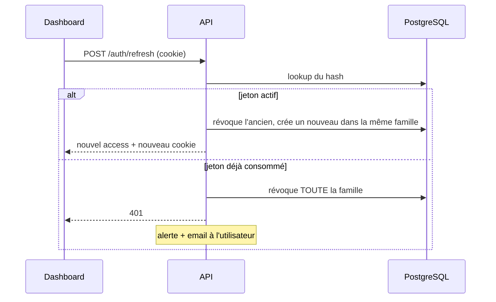

La rotation avec détection de rejeu transforme un vol de cookie en incident détecté plutôt qu'en accès silencieux.

### 6.4 Ajout d'un domaine et émission TLS — v0.2 (D-127)

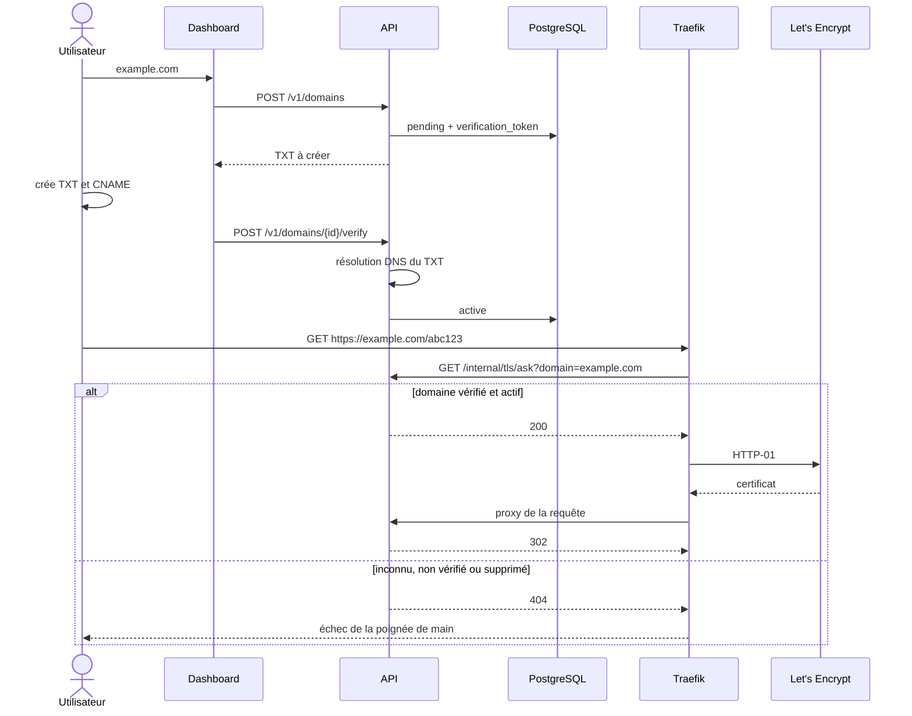

### 6.5 Signalement et retrait

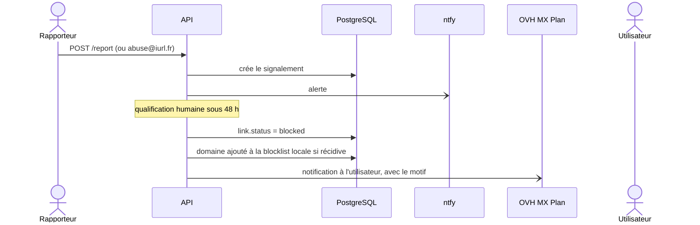

La notification avec motif n'est pas de la politesse : c'est une obligation de motivation du DSA.

### 6.6 Effacement d'un compte

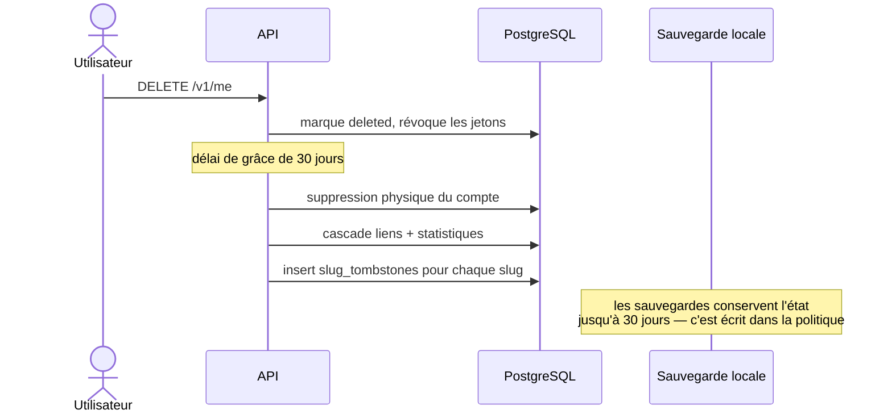

Point de vigilance : sans la copie des slugs dans `slug_tombstones`, un effacement permettrait à un tiers de réclamer le slug et de récupérer les clics des QR déjà imprimés.

### 6.7 Redirection en mode dégradé

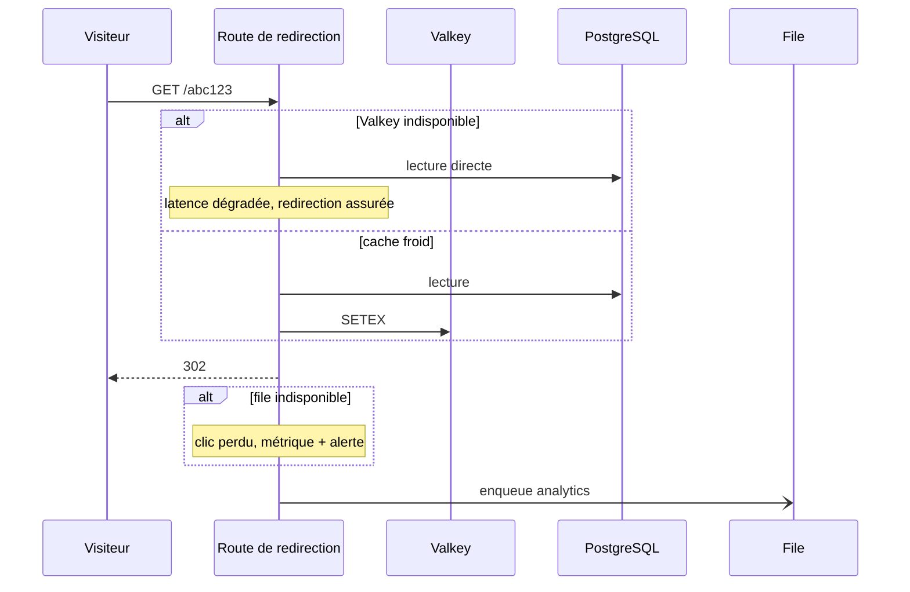

---

## 7. Règles de maintenance

1. **Un diagramme est dans le dépôt**, sous `docs/uml/`, en `.md` avec Mermaid. Jamais une image.
2. **Il se met à jour dans la même PR que le code.** Un diagramme qui décrit un état qui n'existe plus est pire que pas de diagramme.
3. **Une machine à états doit correspondre à une contrainte de la base.** Si le diagramme autorise une transition que la base refuse, c'est la base qui a raison.
4. **Un cas d'utilisation sans endpoint, écran ou test est un trou**, et la matrice du §4 doit rester sans ligne « MANQUANT ».
5. **Pas de diagramme de classes.** Le schéma SQL est la source de vérité, et il est déjà écrit.
